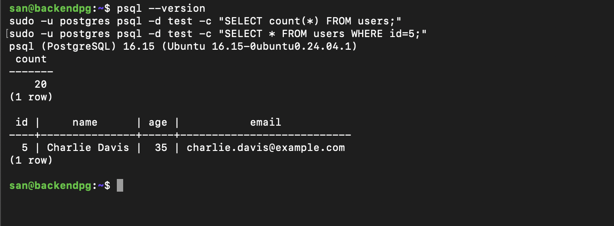
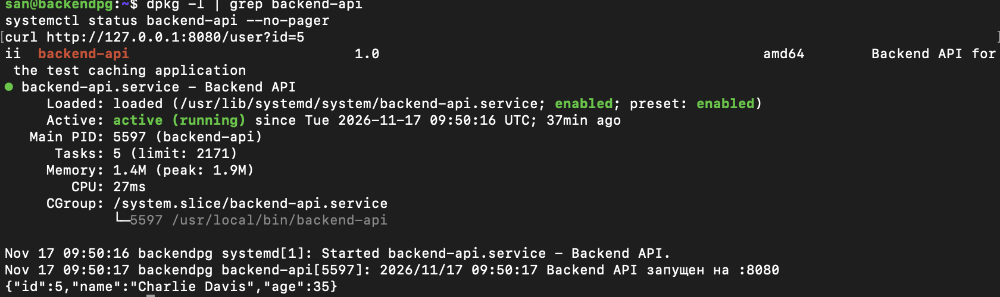
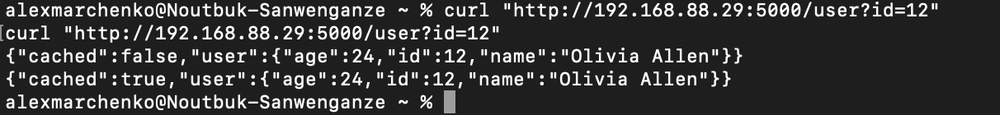
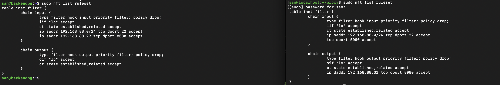
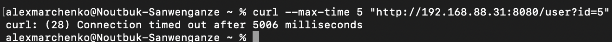

# Тестовое приложение с кеширующим слоем

Стенд из двух ВМ (Hyper-V): Backend API на Go + PostgreSQL и Flask-прокси + Redis.
Прокси проверяет кеш в Redis, при промахе запрашивает данные у Backend, который читает их из PostgreSQL.

## Схема

| ВМ | ОС | IP | Компоненты |
|---|---|---|---|
| backendpg | Ubuntu (Hyper-V) | 192.168.88.31 | PostgreSQL, Backend API (:8080) |
| localhost | CentOS Stream 10 (Hyper-V) | 192.168.88.29 | Redis 7.2.7 (:6379), Proxy (:5000) |

```
клиент --> Proxy :5000 --> Redis (127.0.0.1:6379)
                |
                +--> Backend :8080 --> PostgreSQL (127.0.0.1:5432)
```

## Версии

- PostgreSQL: 16 (БД `test`, таблица `users`, 20 записей из CSV)
- Redis: 7.2.7 (собран из исходников: в репозиториях CentOS Stream 10 есть только Valkey)
- Go-backend: собран из `backend-api.go`
- Proxy: Python 3 + Flask, redis-py, requests, PyYAML (из EPEL/AppStream)

## Структура репозитория

```
.
├── rules.sh                      # сетевые правила (nftables)
├── backend/
│   ├── DEBIAN/control            # спецификация .deb
│   ├── DEBIAN/conffiles
│   ├── backend-api.service       # systemd unit
│   ├── backend-api.go
│   └── config.yaml
├── proxy/
│   ├── cache-api.spec            # спецификация .rpm
│   ├── cache-api.service         # systemd unit
│   ├── cache-api.py
│   └── config.yaml
└── redis/
    └── redis.service             # systemd unit для Redis
```

## Сборка пакетов

### Backend (.deb, Ubuntu)

```bash
cd backend && go mod init backend-api && go mod tidy && go build -o backend-api .
# структура пакета: usr/local/bin/backend-api, etc/backend-api/config.yaml,
# lib/systemd/system/backend-api.service, DEBIAN/control, DEBIAN/conffiles
dpkg-deb --root-owner-group --build backend-api_1.0
sudo dpkg -i backend-api_1.0.deb
sudo systemctl enable --now backend-api
```

### Proxy (.rpm, CentOS)

```bash
# cache-api.py, config.yaml, cache-api.service лежат в ~/rpmbuild/SOURCES
rpmbuild -bb ~/rpmbuild/SPECS/cache-api.spec
sudo rpm -ivh ~/rpmbuild/RPMS/noarch/cache-api-1.0-1*.rpm
sudo systemctl enable --now cache-api
```

## Сетевые правила (`rules.sh`)

Скрипт запускается на каждой ВМ со своим аргументом (используется nftables, политика `drop`):

```bash
sudo bash rules.sh backend   # на backendpg
sudo bash rules.sh proxy     # на CentOS (firewalld предварительно отключён)
```

| Узел | Входящие | Исходящие |
|---|---|---|
| Proxy | :5000 от любого источника | Backend :8080, Redis (loopback) |
| Backend | :8080 только от прокси (192.168.88.29) | только PostgreSQL (loopback) |
| PostgreSQL | только локально (127.0.0.1) | - |

Порт 22 открыт только для администрирования с подсети, указанного в `SSH_FROM`.
Redis и PostgreSQL слушают только localhost.

## Проверка

```bash
# с proxy-ВМ: Backend отвечает
curl http://192.168.88.31:8080/user?id=5

# с внешнего хоста: первый запрос не из кеша, второй из кеша
curl "http://192.168.88.29:5000/user?id=5"   # "cached":false
curl "http://192.168.88.29:5000/user?id=5"   # "cached":true

# с внешнего хоста: Backend заблокирован (таймаут)
curl --max-time 5 "http://192.168.88.31:8080/user?id=5"
```

Кеш в Redis живёт 60 секунд (TTL задан в `cache-api.py`).

## Отличия от выданных исходников

- В `config.yaml` backend ключ `name` заменён на `dbname` (соответствует тегу `yaml:"dbname"` в коде).
- В конфигах вместо имён хостов (`postgres`, `redis`, `backend-api`) указаны IP-адреса.
- В `cache-api.py` небезопасный `eval()` заменён на `json.loads()`, добавлены проверка параметра `id` и таймаут запроса к backend.
- Файл `backend-api.go` пересоздан с корректными переводами строк; логика не менялась (повторяющиеся проверки переменных окружения вынесены в функцию `getenv`).

## Скриншоты

### 1. PostgreSQL: версия, 20 записей и пользователь с id=5


### 2. Backend API: пакет установлен, сервис запущен через systemd, API отвечает


### 3. Proxy: первый запрос из Backend (`cached: false`), повторный из Redis (`cached: true`)


### 4. Сетевая топология: правила nftables (`rules.sh`)


### 5. Проверка блокировки: запрос к Backend с внешнего IP обрывается по таймауту
